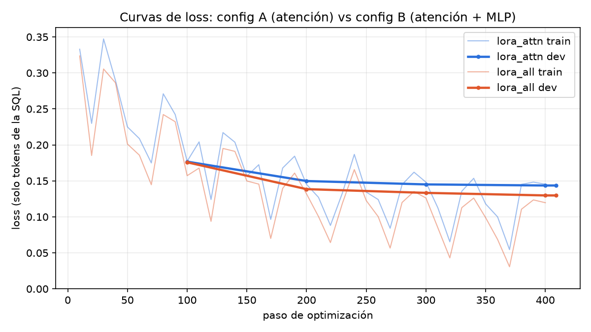
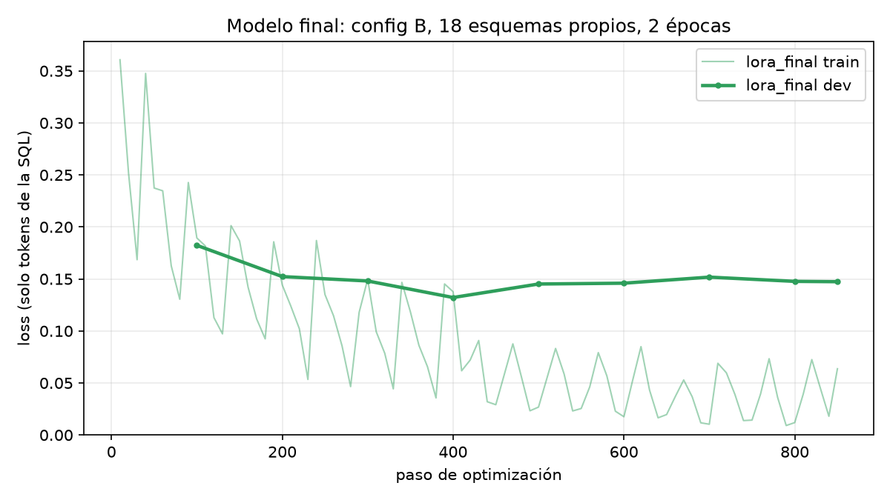
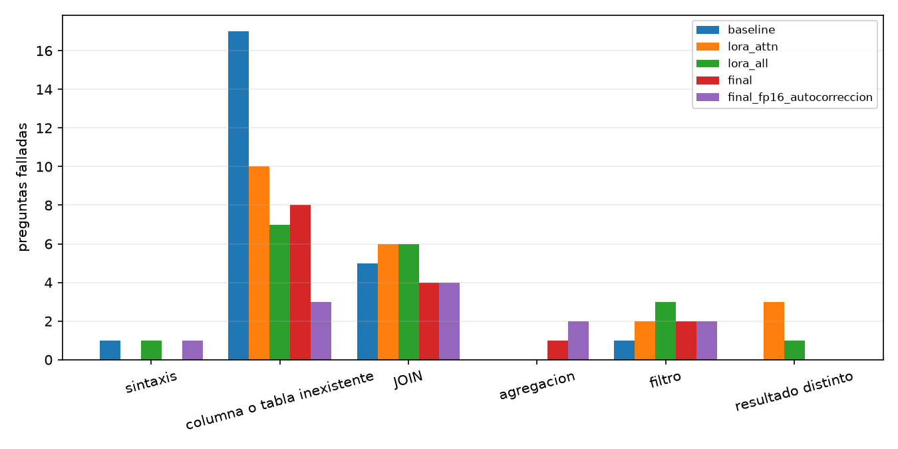

# Proyecto 3 — Text-to-SQL: fine-tuning de un LLM con LoRA

Universidad del Valle de Guatemala · Deep Learning 2026 · Integrantes: Andrés Mazariegos ([@andresm220](https://github.com/andresm220)), June Herrera ([@skemono](https://github.com/skemono))

Modelo base **`Qwen/Qwen2.5-Coder-1.5B-Instruct`** + adapter **LoRA** que, dado el esquema de una base MySQL
(sentencias `SHOW CREATE TABLE` con `COMMENT`) y una pregunta en español, genera una consulta MySQL 8.4.10.

## Resultados en la validación propia (40 preguntas, 2 esquemas no vistos)

| Modelo | EX ponderada | Fácil | Media | Difícil | Consultas que ejecutan |
|---|---|---|---|---|---|
| Baseline (sin adapter) | 0.325 | 7/12 | 8/16 | 1/12 | 22/40 |
| Baseline + autocorrección | 0.375 | 9/12 | 9/16 | 1/12 | 27/40 |
| Config A — LoRA en atención | 0.388 | 10/12 | 6/16 | 3/12 | 30/40 |
| Config B — LoRA en atención + MLP | 0.450 | 10/12 | 10/16 | 2/12 | 32/40 |
| Config B + autocorrección | 0.500 | 10/12 | 12/16 | 2/12 | 34/40 |
| Final (B + 6 esquemas más + 2 épocas) | 0.525 | 11/12 | 11/16 | 3/12 | 32/40 |
| **Final + autocorrección (entregado)** | **0.550** | 11/12 | 12/16 | 3/12 | 35/40 |
| *En fp16, como en la T4 de Colab:* baseline + autocorrección | 0.3125 | 9/12 | 8/16 | 0/12 | 27/40 |
| *En fp16, como en la T4 de Colab:* **final + autocorrección** | **0.6125** | 11/12 | 13/16 | 4/12 | 36/40 |

EX ponderada = Σ pesos de las acertadas / Σ pesos (fácil 1, media 2, difícil 3). Las filas sin marca se calcularon en bf16
(RTX 5070); las filas en fp16 reproducen el cómputo de la T4 de Colab (`evaluar_modelo.py --fp16`). La diferencia
entre bf16 y fp16 (0.55 frente a 0.61) viene solo del redondeo numérico, que cambia algunas decisiones de la búsqueda
voraz. Es una medida del ruido de una validación de 40 preguntas. **Mejora del adapter frente al modelo base con el
mismo prompt y la misma autocorrección: +0.175 en bf16 y +0.30 en fp16.** El detalle por pregunta está en
`resultados/*.csv`; el del modelo entregado en las condiciones de la T4, en `resultados/validacion_propia.csv`.

---

## 1. Ejecución

### Usar la solución (lo que corre el evaluador)

```python
from solucion import generar_sql        # carga el modelo al importar (~15 s en T4 tras la descarga)
sql = generar_sql(esquema, pregunta, ejecutar=None)
```

- `config.json` define el modelo base, la carpeta del adapter, `usar_adapter` y la semilla. Con
  `"usar_adapter": false` se usa el modelo base con **el mismo prompt**.
- Generación determinista: búsqueda voraz (`do_sample=False`), `torch.manual_seed(2026)`.
- Si se entrega `ejecutar`, la consulta se prueba; si MySQL devuelve error, se le muestra el error al modelo y se le
  pide corregirla (máximo 3 llamadas a `ejecutar`, con un tope de tiempo interno de 22 s por pregunta).
- La salida siempre es una única sentencia: se toma la primera `SELECT`/`WITH` y se corta en el primer `;`.
- dtype: bf16 en GPU con capacidad ≥ 8.0, **fp16 en T4**, fp32 en CPU.

### Google Colab (T4)

```bash
!git clone <repo> proyecto && cd proyecto
!pip install -r requirements.txt     # usa el torch preinstalado de Colab
```

Verificado localmente simulando T4 (fp16): carga en 12 s, entre 1 y 4 s por pregunta y salida idéntica entre corridas.

### Reproducir todo

Requisitos: Docker con `mysql:8.4.10` y una GPU con ≥ 6 GB.

```bash
docker run -d --name mysql84 -e MYSQL_ROOT_PASSWORD=root -p 3306:3306 mysql:8.4.10
python -m venv .venv && .venv/Scripts/pip install torch --index-url https://download.pytorch.org/whl/cu130
.venv/Scripts/pip install -r requirements.txt datasets pandas matplotlib sentencepiece sacremoses gdown
gdown 1403EGqzIDoHMdQF4c9Bkyl7dZLZ5Wt6J -O spider_data.zip && unzip spider_data.zip -d C:/spider_dl

python scripts/spider_a_mysql.py C:/spider_dl/spider_data     # Spider -> MySQL + descartes
python scripts/traducir_spider.py C:/spider_dl/spider_data    # preguntas al español
python scripts/construir_dataset.py                           # entrenamiento, validación, descartes
python scripts/evaluar_modelo.py --nombre baseline --sin-adapter
python scripts/entrenar.py --nombre lora_attn --modulos attn --batch 1 --acum 16 --max_spider 4000
python scripts/entrenar.py --nombre lora_all  --modulos all  --batch 1 --acum 16 --max_spider 4000
python scripts/entrenar.py --nombre lora_final --modulos all --batch 1 --acum 16 --max_spider 3000 --epocas 2
python scripts/evaluar_modelo.py --nombre lora_all --adapter checkpoints/lora_all/adapter [--autocorreccion]
python scripts/graficas.py
```

Las configs A y B se entrenaron con `datos/entrenamiento_v1.jsonl` (12 esquemas propios). El modelo final usa
`datos/entrenamiento.jsonl` (18 esquemas propios).

### Estructura

```
solucion.py, config.json, requirements.txt, adapter/     entrega
datos/          entrenamiento.jsonl (v2), entrenamiento_v1.jsonl, validacion_propia.jsonl, descartes.csv,
                esquemas_propios/ (18 esquemas .sql + pares .jsonl), validacion/ (2 esquemas + 40 preguntas),
                resumen_dataset.json, descartes_spider.csv
notebooks/      01_datos, 02_entrenamiento, 03_evaluacion
resultados/     validacion_propia.csv (modelo entregado), <experimento>.csv, resumen.json, metricas_*.json, *.png
scripts/        db.py, spider_a_mysql.py, traducir_spider.py, construir_dataset.py, validar_pares.py,
                entrenar.py, evaluar.py, evaluar_modelo.py, graficas.py, crear_notebooks.py
```

---

## 2. Dataset de entrenamiento

| Fuente | Pares válidos | Esquemas |
|---|---|---|
| Spider (train + others + dev) → MySQL, preguntas traducidas al español | 8 828 | 166 |
| Esquemas propios, pares generados con LLM | 1 330 (844 en v1) | 18 (12 en v1) |
| **Total de pares únicos** | **10 158** | 184 |

**Spider → MySQL** (`scripts/spider_a_mysql.py`): cada base SQLite se carga en MySQL infiriendo el tipo de cada columna a
partir de sus datos (INT, DOUBLE, DATE, VARCHAR), con PK y FK. Cada consulta se transpila con `sqlglot`, ajustando las
mayúsculas de los nombres de tabla (MySQL en Linux distingue mayúsculas), y se ejecuta en MySQL 8.4.10 y en SQLite.
**Solo se conserva si ejecuta sin error y da el mismo resultado que en SQLite.** El esquema de cada ejemplo es el
`SHOW CREATE TABLE` real de MySQL. La mitad de las bases (elegidas por hash) recibe `COMMENT` en español con el nombre
natural de cada columna, para que el modelo aprenda a aprovecharlos.

**Traducción** (`scripts/traducir_spider.py`): `Helsinki-NLP/opus-mt-en-es`. Los literales de la SQL que aparecen en
la pregunta se reemplazan por marcadores (`XV0`, …) antes de traducir y se restauran después: así `'Switzerland'` no se
convierte en "Suiza" y la pregunta sigue coincidiendo con los datos.

**Esquemas propios** (`datos/esquemas_propios/`): 18 dominios (tienda online, hospital, biblioteca, universidad,
aerolínea, delivery, RRHH, banco, música, inventario, liga de fútbol, hotel, veterinaria, gimnasio, inmobiliaria,
logística, cine, proyectos de software). Tienen de 6 a 8 tablas, nombres en español o inglés, completos o abreviados
(`cli`, `f_ing`, `ln_dt`), `COMMENT` en español y datos realistas. Los pares (65 a 81 por esquema) se reparten en
~25 % fáciles, ~40 % medios y ~35 % difíciles, con CTE, funciones de ventana, fechas, LEFT JOIN con conteos en cero y
subconsultas correlacionadas, que son justamente los patrones que Spider casi no tiene. Cada par se validó ejecutándolo
(`scripts/validar_pares.py`: 0 errores, 0 resultados vacíos). En entrenamiento se repiten ×3.

### Descartes (`datos/descartes.csv`, 865 en total)

| Motivo | Pares | Por qué |
|---|---|---|
| `resultado_distinto_sqlite` | 408 | Corre en MySQL pero devuelve otra cosa: división entera, comparación de texto sin distinguir mayúsculas, empates con `LIMIT`, etc. |
| `error_mysql` | 191 | `ONLY_FULL_GROUP_BY`, palabras reservadas sin comillas, funciones propias de SQLite. |
| `esquema_demasiado_largo` | 183 | Prompt + respuesta > 2 048 tokens (no cabe en el entrenamiento con 8 GB de VRAM). |
| `traduccion_perdio_valor` | 83 | El traductor alteró un literal que la consulta necesita. |
| (pares propios con error) | 0 | — |

## 3. Validación propia

`datos/validacion/`: **`taller_mecanico`** (8 tablas, español abreviado: `cli`, `veh`, `ord_srv`, `det_ord`…) y
**`conference_events`** (8 tablas, inglés: `evt`, `venue`, `ticket`, `sponsor`…). 20 preguntas por esquema: 6 fáciles,
8 medias y 6 difíciles, cada una con su SQL de referencia y la marca `ordenado`. La partición es **por esquema**:
ninguno de estos dominios ni tablas aparece en entrenamiento (`construir_dataset.py` lo verifica con un `assert`). Las
preguntas incluyen trampas realistas: LEFT JOIN con conteos en cero, sumas de cabecera y detalle que no deben contar
doble, filtros por estado deducidos del `COMMENT`, empates.

El evaluador (`scripts/evaluar.py`) aplica las reglas del enunciado. El orden de filas solo cuenta si la pregunta lo
pide. Los números se redondean a 2 decimales. Una columna adicional no penaliza: se busca una asignación de columnas
de la predicción a las de referencia. Tiene autotests: `python scripts/evaluar.py`.

## 4. Prompt

```
system: Eres un experto en bases de datos MySQL 8.4. Recibes el esquema … Responde únicamente con una consulta SQL …
user:   Esquema:
        <CREATE TABLE … compactados>
        Pregunta: <pregunta>
```

`compactar_esquema` quita del `SHOW CREATE TABLE` lo que no aporta (`ENGINE`, `CHARSET`, `COLLATE`, índices
secundarios y nombres de `CONSTRAINT`) y conserva columnas, tipos, `COMMENT`, PK, FK y UNIQUE. El mismo prompt se usa
en entrenamiento, en el baseline y con o sin adapter.

## 5. Configuraciones de LoRA

Hiperparámetros comunes: r = 16, α = 32, dropout 0.05, lr 2e-4 con coseno y 3 % de warmup, batch efectivo 16 (1 × 16),
1 época, bf16, gradient checkpointing. La pérdida se calcula solo sobre los tokens de la SQL. Para que quepa en 8 GB, los
logits se calculan solo para la respuesta (`logits_to_keep` + padding a la izquierda, ver `TrainerRespuesta`). Datos:
6 532 ejemplos (los 844 pares propios ×3 + 4 000 de Spider). GPU: RTX 5070 Laptop (8 GB).

**Factor que cambia: los módulos con LoRA.**

**Hipótesis, escrita antes de entrenar:** B tendrá menor loss de validación y mayor EX que A. Las capas MLP concentran la mayoría
de los parámetros y es donde se guardan los patrones de generación (dialecto MySQL, estructura de CTE y ventanas). Adaptar solo la
atención cambia sobre todo *a qué columnas mira* el modelo, no tanto *qué escribe*. Esperamos que A ya mejore sobre el
baseline (copiar nombres del esquema en vez de inventarlos) y que B mejore además en las preguntas medias y difíciles.

| | Config A `lora_attn` | Config B `lora_all` |
|---|---|---|
| Módulos | q, k, v, o | q, k, v, o, gate, up, down |
| Parámetros entrenables | 4 358 144 (0.28 %) | 18 464 768 (1.18 %) |
| Tiempo de entrenamiento | 77.7 min | 92.7 min |
| VRAM máxima | 3.76 GB | 4.11 GB |
| Loss dev (paso 100 → final) | 0.177 → 0.144 | 0.176 → 0.130 |
| EX ponderada (sin / con autocorrección) | 0.388 / — | 0.450 / 0.500 |



**Resultado: se confirma la hipótesis.** B baja más la loss de dev (0.130 frente a 0.144) y sube la EX de 0.388 a 0.450,
casi todo en las preguntas medias (6/16 → 10/16). A mejora las fáciles (7 → 10 de 12) y reduce las columnas
inventadas (17 → 10), pero empeora las medias respecto del baseline. B cuesta cuatro veces más parámetros y un 19 % más
de tiempo. La loss de train oscila porque `group_by_length` alterna lotes largos (esquemas propios, más difíciles) con
lotes cortos (Spider).

**Modelo final:** la config B con 6 esquemas propios más (486 pares nuevos, centrados en los errores observados:
JOIN de 3–4 tablas, LEFT JOIN con `COUNT(col)`, pre-agregación de detalle, la misma tabla unida dos veces) y 2 épocas,
porque la loss de dev de B seguía bajando al final. 6 795 ejemplos (los 1 330 pares propios ×3 + 3 000 de Spider),
141 min.



La loss de dev del modelo final llega a su mínimo al terminar la primera época (0.132 en el paso 400) y sube un poco
durante la segunda (0.147): hay algo de sobreajuste al estilo de los datos propios. Aun así la EX en la validación
propia sube de 0.450 a 0.525 sin autocorrección y de 0.500 a 0.550 con ella. Mejoran sobre todo las preguntas difíciles
(2 → 3 de 12) y bajan los errores de JOIN (6 → 4). Como la loss de dev mide la probabilidad de *una* forma de escribir
la consulta y la EX acepta cualquier consulta equivalente, nos quedamos con el modelo de 2 épocas. El dev del modelo
final no es exactamente el mismo que el de A y B, porque incluye ejemplos de los esquemas nuevos, así que esa curva no
se compara directamente con las de A y B.

## 6. Experimento de inferencia: autocorrección con `ejecutar`

La consulta generada se ejecuta. Si MySQL devuelve error, se agrega al diálogo el mensaje de error
(*"La consulta falló en MySQL con este error: … Corrígela"*) y se vuelve a generar, como máximo 2 veces.

| | sin `ejecutar` | con autocorrección | Δ |
|---|---|---|---|
| Baseline | 0.325 | 0.375 | +0.050 |
| Config B | 0.450 | 0.500 | +0.050 |
| Final | 0.525 | 0.550 | +0.025 |

La autocorrección arregla sobre todo errores de **columna inexistente** (B: 7 → 5; final: 8 → 4) y sube las
consultas que ejecutan (B: 32 → 34; final: 32 → 35). No arregla errores semánticos: si la consulta corre pero responde otra cosa, no hay señal que la corrija. Cuesta
poco: modelo final, 3.1 s de promedio por pregunta y 18.1 s en el peor caso, bajo el límite de 30 s gracias al tope
interno de 22 s. Queda activada en la entrega.

## 7. Análisis de errores por categoría

Clasificación automática (`categoria_error` en `scripts/evaluar.py`), revisada a mano:

| Categoría | Baseline | Config A | Config B | B + autocorr. | Final | Final + autocorr. | Final + autocorr. (fp16) |
|---|---|---|---|---|---|---|---|
| sintaxis | 1 | 0 | 1 | 1 | 0 | 1 | 1 |
| columna o tabla inexistente | 17 | 10 | 7 | 5 | 8 | 4 | 3 |
| JOIN | 5 | 6 | 6 | 6 | 4 | 5 | 4 |
| agregación | 0 | 0 | 0 | 0 | 1 | 2 | 2 |
| filtro | 1 | 2 | 3 | 3 | 2 | 2 | 2 |
| resultado distinto | 0 | 3 | 1 | 1 | 0 | 0 | 0 |
| **total de fallos** | 24 | 21 | 18 | 16 | 15 | 14 | 12 |



Patrones observados:
- **Columnas inventadas o tomadas de la tabla equivocada.** Es el error dominante del baseline: inventa `t.att_first_name`, `d.mo + d.re`
  o pone la `ciu` del cliente en `veh`. El fine-tuning lo reduce de 17 a 8 y la autocorrección a 3–4. Los que quedan son
  casos en que la columna existe en otra tabla (`km` está en `veh` y también en `ord_srv`): la consulta corre, pero
  responde otra cosa.
- **Agregación en dos niveles.** Escribe `SUM(o.costo_mo + SUM(d.cant * d.p_unit))` (agregados anidados) o se salta la
  comparación con el promedio ("más que el promedio de su servicio" sin subconsulta).
- **JOIN incompleto.** La columna pedida está a 2–3 saltos (cliente → vehículo → orden) y el modelo toma un atajo
  inexistente o se salta la tabla intermedia (`venue.city` pedido como `evt.city`).
- **`COUNT(*)` con LEFT JOIN.** Las filas sin coincidencias cuentan 1 en vez de 0. Es un error semántico que la
  autocorrección no ve.
- **Filtros.** Ignora un valor explícito ("taller (workshop)" generado como `'talk'`) o se salta `IS NOT NULL`.
- **Difíciles (3–4 de 12).** Combinar dos agregaciones de tablas distintas sin contar doble, o un promedio correlacionado por
  grupo, sigue fuera del alcance del modelo de 1.5B en la mayoría de los casos.

## 8. Predicción justificada de la EX en la evaluación oculta

**Predicción: EX ponderada ≈ 0.55 con adapter (intervalo razonable 0.42–0.68) y ≈ 0.33 sin adapter, es decir, una
mejora de alrededor de +0.20.**

Justificación:
1. **Punto de partida.** La validación propia imita el formato de la evaluación oculta: esquemas de 6 a 8 tablas, nombres
   abreviados ES/EN con `COMMENT`, 3 niveles, columnas indicadas en la pregunta y esquemas nunca vistos. En ella el modelo
   entregado obtiene 0.55 (bf16) y 0.61 (fp16, el cómputo de la T4).
2. **Por nivel.** Fácil ≈ 92 %, media ≈ 75–80 %, difícil ≈ 25–33 %. Con una mezcla típica de 12 fáciles, 14 medias y
   10 difíciles (pesos 12 + 28 + 30 = 70): (12·0.92 + 28·0.77 + 30·0.29) / 70 ≈ 0.59. Si la evaluación trae más
   difíciles, baja hacia 0.50.
3. **Incertidumbre.** Con 30–40 preguntas, cada difícil vale ≈ 4 % de la nota. La diferencia bf16/fp16 (6 puntos
   solo por redondeo) muestra que el error estándar es de ~0.08. De ahí el intervalo de ±0.13.
4. **Sesgos.** A favor: nuestras preguntas tienen trampas a propósito (LEFT JOIN con ceros, cabecera + detalle sin
   contar doble), que el docente podría no incluir en tanta proporción. En contra: la validación la escribimos nosotros
   y los esquemas propios de entrenamiento tienen un estilo parecido, así que puede sobreestimar. Además, nombres muy
   abreviados sin `COMMENT` o fechas en formatos raros nos costarían más.
5. **Mejora sobre el base.** La mejora es estable entre condiciones: +0.125 (B), +0.175 (final, bf16) y +0.30 (final,
   fp16). Esperamos superar el umbral de +0.15. La meta de 0.70 es probablemente inalcanzable para un modelo de 1.5B
   en preguntas difíciles.

## 9. Licencias

- Código de este repositorio: MIT.
- `Qwen/Qwen2.5-Coder-1.5B-Instruct`: Apache 2.0. El adapter LoRA es un derivado bajo la misma licencia.
- Spider (Yu et al., 2018): CC BY-SA 4.0. La versión traducida y convertida a MySQL de `datos/` hereda CC BY-SA 4.0.
- `Helsinki-NLP/opus-mt-en-es`: CC BY 4.0 (solo se usó para traducir los datos, no en la inferencia).
- MySQL 8.4.10 Community: GPL v2 (solo como motor de validación).

